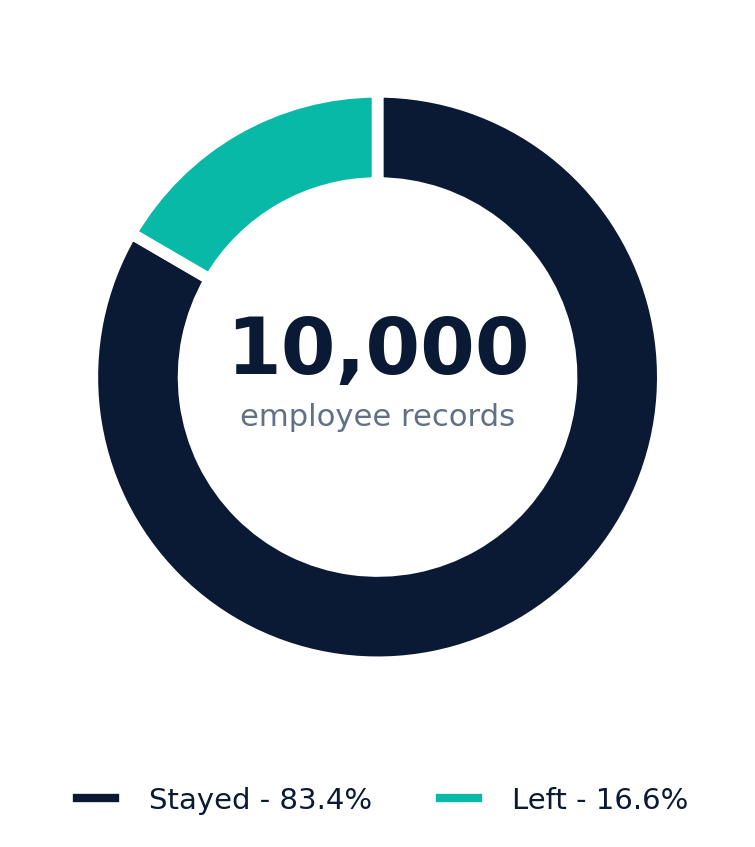
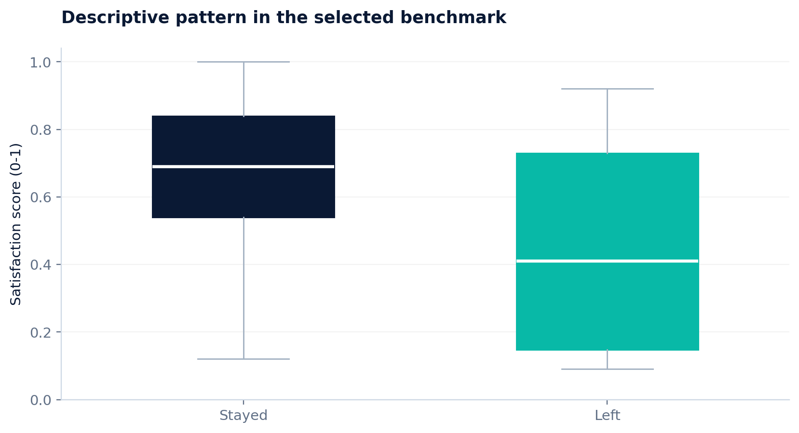
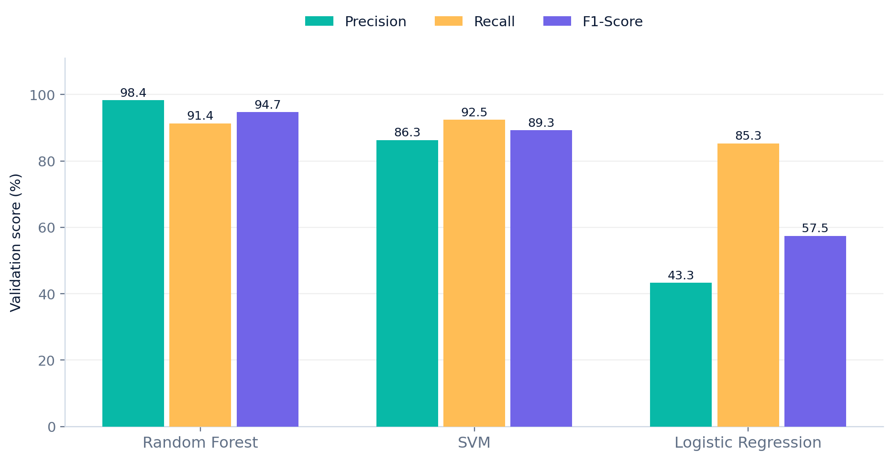
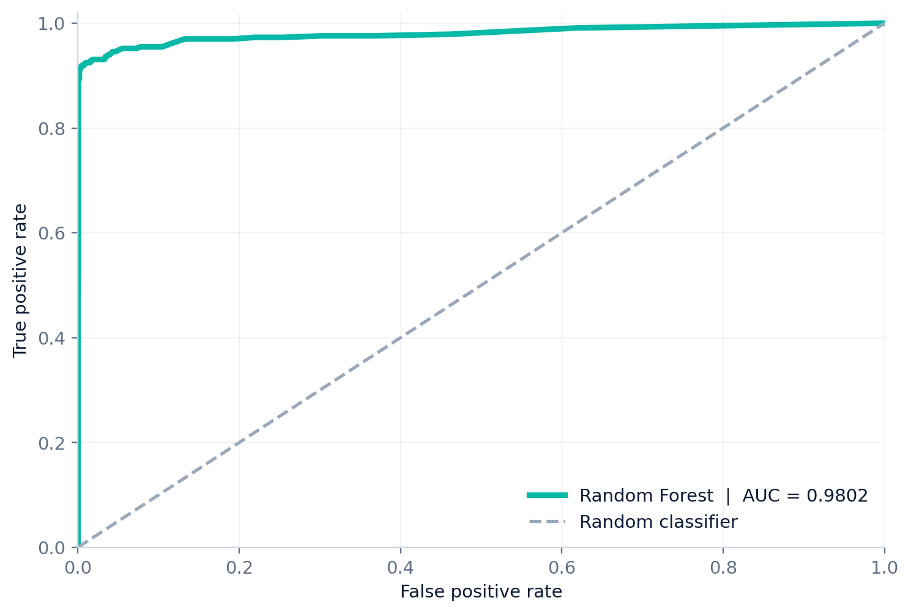
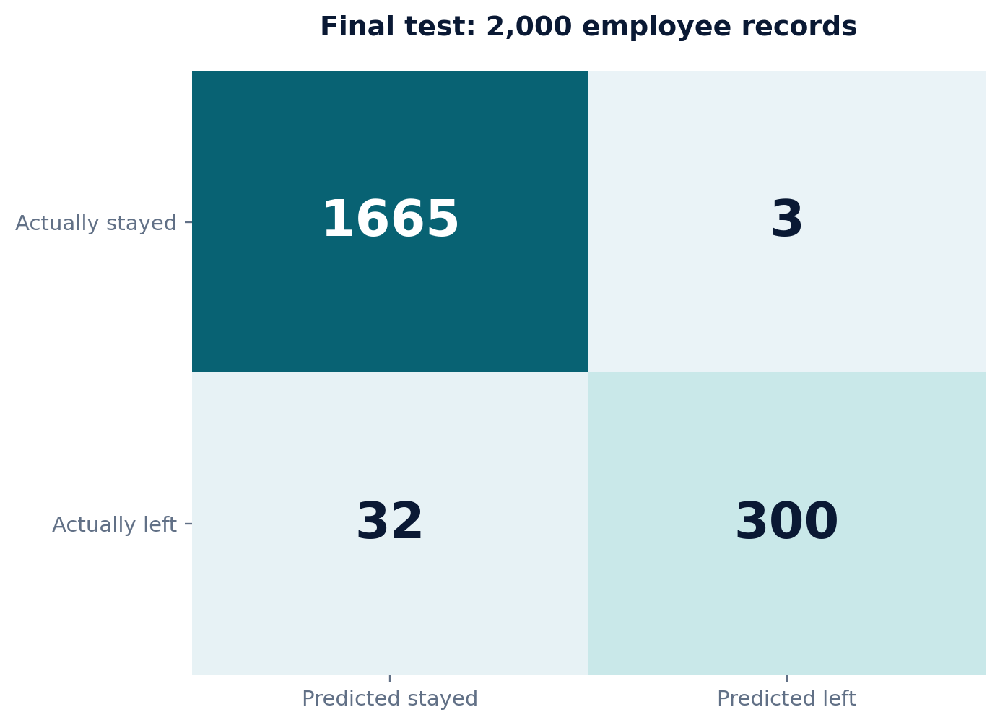

# Employee Attrition Prediction | 10,000-Row ML Benchmark

**Academic machine-learning project | University of Lahore**

| Dataset | Best model | Test accuracy | Test F1-score | Test ROC-AUC |
|:---:|:---:|:---:|:---:|:---:|
| **10,000 rows** | **Random Forest** | **98.25%** | **94.49%** | **0.9802** |

[View research report (PDF)](docs/Employee_Attrition_Research_Report_Footer_Clean.pdf) · [View presentation](docs/Employee_Attrition_Research_Presentation_6_Slides.pptx) · [Open notebook](notebooks/Employee_Attrition_10000_Google_Colab.ipynb)

Project students (from the original submitted article): **Abdul Rehman** and **Muhammad Rizwan**.

This project compares **Logistic Regression, Random Forest, and SVM** for binary employee attrition prediction on a stratified 10,000-row subset of a public HR Analytics educational benchmark. The target is `Attrition` (`Yes` = employee left, `No` = stayed).

> **Research caution:** the underlying source is a widely used public HR benchmark, not a verified real-world employer dataset. These results should not be used to make employment decisions. The earlier IBM project (1,470 rows / 35 columns) and this dataset are different experiments; their accuracies are **not directly comparable**.

## Experiment at a glance

- **Rows / columns:** 10,000 observations / 10 dataset columns (9 inputs + 1 target).
- **Class distribution:** 1,660 left; 8,340 stayed.
- **Split:** 64% train, 16% validation, 20% held-out test (stratified; random state `42`).
- **Selection:** highest validation F1-score, then refit the winner on the 80% development set and evaluate the final test once.
- **Preprocessing:** median/mode imputation, standardization and one-hot encoding within the pipeline (prevents test-set leakage).
- **Resampling:** no SMOTE in this run.

### Validation metrics

| Model | Accuracy | Precision | Recall | F1-score | ROC-AUC |
|---|---:|---:|---:|---:|---:|
| Random Forest | 98.31% | 98.38% | 91.35% | 94.74% | 0.9860 |
| SVM | 96.31% | 86.32% | 92.48% | 89.29% | 0.9782 |
| Logistic Regression | 79.00% | 43.32% | 85.34% | 57.47% | 0.8486 |

### Final holdout test (Random Forest)

| Accuracy | Precision | Recall | F1-score | ROC-AUC |
|---:|---:|---:|---:|---:|
| **98.25%** | **99.01%** | **90.36%** | **94.49%** | **0.9802** |

Confusion matrix: TN = 1,665; FP = 3; FN = 32; TP = 300. All metrics refer to the positive class (`Attrition=Yes`) except overall accuracy and ROC-AUC.

## Visual results

These figures are included in the repository and display directly on GitHub. The [PDF research report](docs/Employee_Attrition_Research_Report_Footer_Clean.pdf) contains the full write-up.

### Dataset and split

| Class distribution | Satisfaction distribution |
|:---:|:---:|
|  |  |

<p align="center"></p>

### Model comparison and evaluation

| Validation comparison | ROC curve |
|:---:|:---:|
|  |  |

<p align="center"></p>

## Getting started

### Colab

Open [`notebooks/Employee_Attrition_10000_Google_Colab.ipynb`](notebooks/Employee_Attrition_10000_Google_Colab.ipynb) in Google Colab and upload the accompanying dataset workbook when prompted. The notebook saves metrics and the trained scikit-learn pipeline.

### Python CLI

```bash
python -m pip install -r requirements.txt
python src/prepare_dataset.py --source path/to/HR_comma_sep.csv --output data/Employee_Attrition_10000_Training_Dataset.xlsx
python src/train.py --input data/Employee_Attrition_10000_Training_Dataset.xlsx --output-dir results/reproduced
```

The training script writes validation and final metrics, a confusion matrix, classification report, ROC curve and a serialized model (do not load untrusted `.joblib`/`.pkl` files).

## Project structure

```text
.
├── src/
│   ├── prepare_dataset.py
│   └── train.py
├── notebooks/
│   └── Employee_Attrition_10000_Google_Colab.ipynb
├── data/README.md
├── results/
│   ├── validation_comparison.csv
│   ├── final_test_metrics.csv
│   ├── final_confusion_matrix.csv
│   └── visual figures (.png)
├── docs/
│   ├── Employee_Attrition_Research_Report_Footer_Clean.pdf
│   └── Employee_Attrition_Research_Presentation_6_Slides.pptx
├── requirements.txt
├── CITATION.cff
└── LICENSE
```

## Sources and research boundaries

- Public source: [Human-Resources-Analytics](https://github.com/RuchitaGarde/Human-Resources-Analytics) (`HR_comma_sep.csv`, snapshot SHA `2268a0b2e798a7cfd233fd044ee5a919242d2591`).
- Library: [scikit-learn](https://scikit-learn.org/stable/).
- This repository reproduces the user's submitted 10,000-row experiment results. It is **not** a publication or independently externally validated HR predictive system.
- Source dataset is not bundled until its license/redistribution terms are confirmed. The MIT license here applies to the **original code and documentation**, not the external source dataset.

## Responsible use

A model can reproduce patterns in a synthetic educational dataset without generalizing to actual employees. Fairness assessment, calibration, drift monitoring, and external-company/time holdouts are needed before any real-world exploration. Human resources decisions must not be delegated to model scores.

## License

Original project code and authored documentation: [MIT](LICENSE). Third-party source data is **excluded** from this grant.
